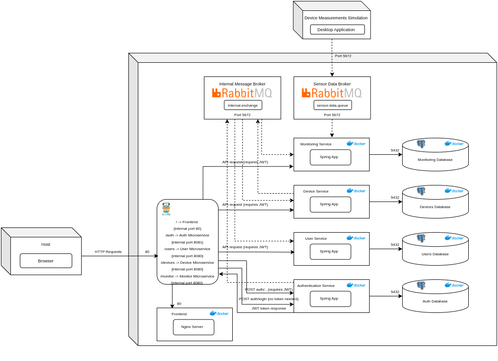

# Distributed Energy Consumption Management System

An event-driven, microservices-based platform for real-time smart metering, energy consumption monitoring, and user/device management. Built with **Java 25 (Spring Boot)** and **React**, the system leverages **Traefik** as an API Gateway, **RabbitMQ** brokers for asynchronous state synchronization and high-throughput telemetry ingestion, custom **load balancing** across horizontally scaled monitoring replicas, **WebSockets** for instant overconsumption alerts and live chat, **Google Gemini AI** for automated customer support, and **PostgreSQL** in a strict database-per-service architecture.



## Table of Contents

- [Architecture Overview](#architecture-overview)
- [Key Highlights](#key-highlights)
- [Authentication and Authorization](#authentication-and-authorization)
- [Setup and Deployment](#setup-and-deployment)
- [API Documentation](#api-documentation)

---

## Architecture Overview

The system is decomposed into independent, containerized services orchestrated via Docker Compose:

- **Traefik (API Gateway & Reverse Proxy)** – Entry point for all HTTP traffic. Handles dynamic routing, path stripping, and edge JWT validation before forwarding identity claims (`X-User`, `X-Role`) to downstream services.
- **Frontend** – React single-page application served via Nginx, providing role-based dashboards, interactive hourly consumption charts, real-time alert notifications, community chat, and an AI support assistant.
- **Auth Service** – Manages user credentials, authentication, and HS256 JWT issuance. Acts as the source of truth for user lifecycle events (`USER_CREATED`, `USER_DELETED`).
- **User Service** – Manages user profiles and metadata, asynchronously synchronized with the Auth Service via RabbitMQ events.
- **Device Service** – Manages smart devices and maximum consumption thresholds. Consumes user lifecycle events to enforce referential integrity and emits device lifecycle events (`DEVICE_CREATED`, `DEVICE_DELETED`).
- **Device Data Simulator** – Standalone producer simulating smart-meter telemetry streams (10-minute intervals, peak-hour scaling, and random consumption spikes).
- **Load Balancer Service** – Consumes raw telemetry from the sensor broker and deterministically partitions messages (`deviceId % N`) across dedicated monitoring queues.
- **Monitor Service (3 Replicas)** – Horizontally scaled consumers that ingest partitioned telemetry, aggregate hourly energy consumption, and trigger immediate alerts when readings exceed device thresholds.
- **WebSocket Service** – Manages persistent STOMP/SockJS connections to push real-time overconsumption alerts to specific users, broadcast global community chat, and serve a hybrid rule-based + **Google Gemini LLM** support bot.
- **Dual RabbitMQ Brokers** – Separates external high-frequency sensor ingestion (`rabbitmq`) from internal domain events and alerting (`rabbitmq-internal`).
- **PostgreSQL Databases** – Four isolated database instances (`auth-db`, `users-db`, `devices-db`, `monitor-db`) ensuring loose coupling and independent data ownership.

---

## Key Highlights

- **Event-Driven Data Consistency:** Maintains eventual consistency across isolated PostgreSQL databases without synchronous cross-service RPC calls by publishing domain events (`user.#`, `device.#`) over a RabbitMQ Topic Exchange (`internal.exchange`).
- **Stateful Stream Partitioning & Horizontal Scaling:** The custom Load Balancer routes readings by `deviceId % MONITOR_INSTANCES_COUNT` into dedicated queues (`monitor.queue.0..2`), guaranteeing that all readings for a given device hit the same `MonitorService` replica for accurate in-memory hourly window aggregation.
- **Broker Isolation:** Decouples high-volume IoT sensor traffic from critical internal control-plane events using two separate RabbitMQ clusters.
- **Gateway Offloaded Security:** Centralizes JWT verification at the Traefik edge via middleware plugins; backend Spring Boot microservices remain stateless and authorize requests via lightweight security filters (`HeaderAuthBridgeFilter`).
- **Real-Time Alerting & AI Support:** Combines asynchronous queue processing with STOMP WebSockets to deliver sub-second browser alerts on overconsumption and integrates `gemini-2.5-flash` for context-aware customer support.
- **Automated CI/CD Pipeline:** GitHub Actions workflow builds multi-service Docker images, pushes to Docker Hub, deploys to an Azure VM over SSH, and executes automated health and smoke tests across all containers, databases, and brokers.

---

## Authentication and Authorization

### Authentication Flow

1. The user logs in via the frontend.
2. The frontend sends credentials to the Auth Service (`POST /auth/login`).
3. The Auth Service returns a signed JSON Web Token (JWT).
4. The frontend stores the token in the browser's `localStorage` and attaches it in the `Authorization: Bearer <token>` header on subsequent requests.
5. Traefik validates the token signature and claims at the gateway and forwards authenticated requests with injected `X-User` and `X-Role` headers to the backend services.

### Roles

- **`ROLE_USER`:** Access to personal profile data, assigned smart devices, historical energy consumption charts, real-time alerts, and chat features.
- **`ROLE_ADMIN`:** Full access to user registration, account/device management, and system-wide endpoints.

---

## Setup and Deployment

### Prerequisites

- Docker
- Docker Compose

### Create the External Network

Before starting the services, create the shared Docker network:

```bash
docker network create demo_net
```

### Start the Application

Run all services from the project root directory:

```bash
docker-compose up -d
```

This pulls/builds and starts all containers in detached mode.

### Access Points

- **Frontend:** `http://localhost`
- **Traefik Dashboard:** `http://localhost:8080`
- **Sensor RabbitMQ Management:** `http://localhost:15672`
- **Internal RabbitMQ Management:** `http://localhost:15673`

---

## API Documentation

Swagger UI is available for each REST backend service through the gateway:

- **Auth Service:** `http://localhost/auth/swagger-ui/index.html`
- **User Service:** `http://localhost/users/swagger-ui/index.html`
- **Device Service:** `http://localhost/devices/swagger-ui/index.html`
- **Monitor Service:** `http://localhost/monitor/swagger-ui/index.html`

For testing the APIs, the same `http://localhost/` root path can be used.